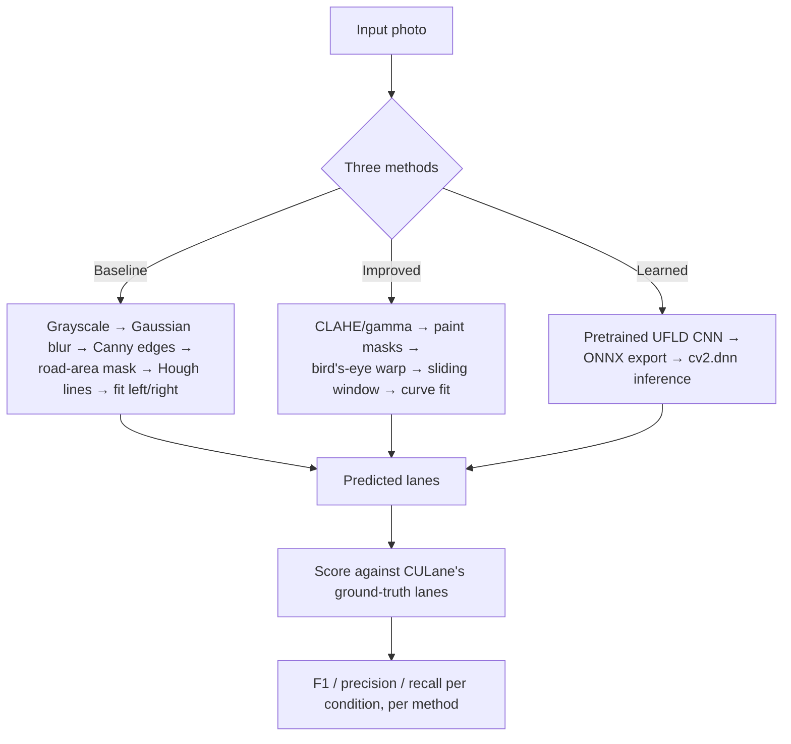
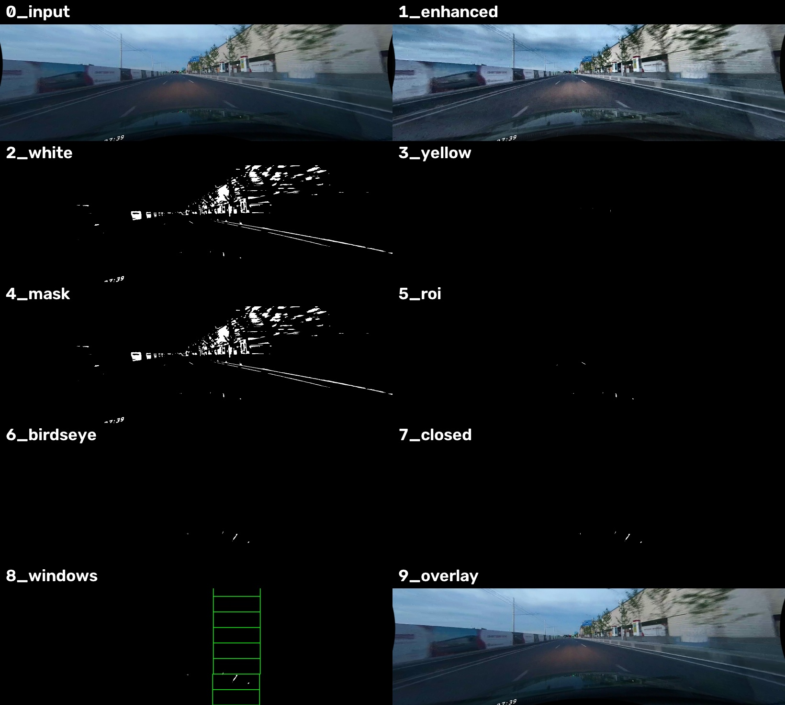
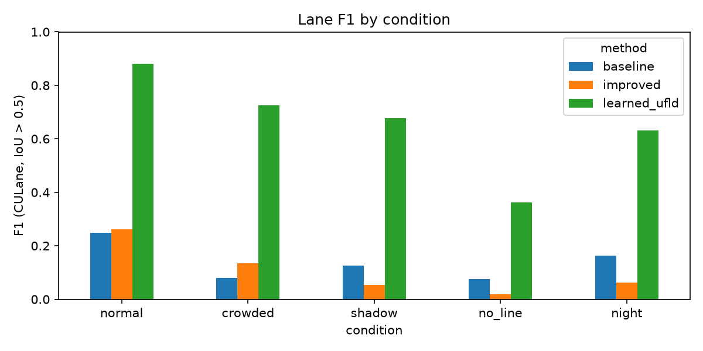
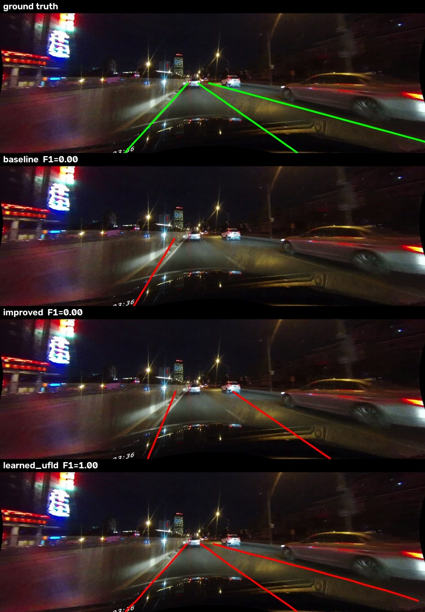
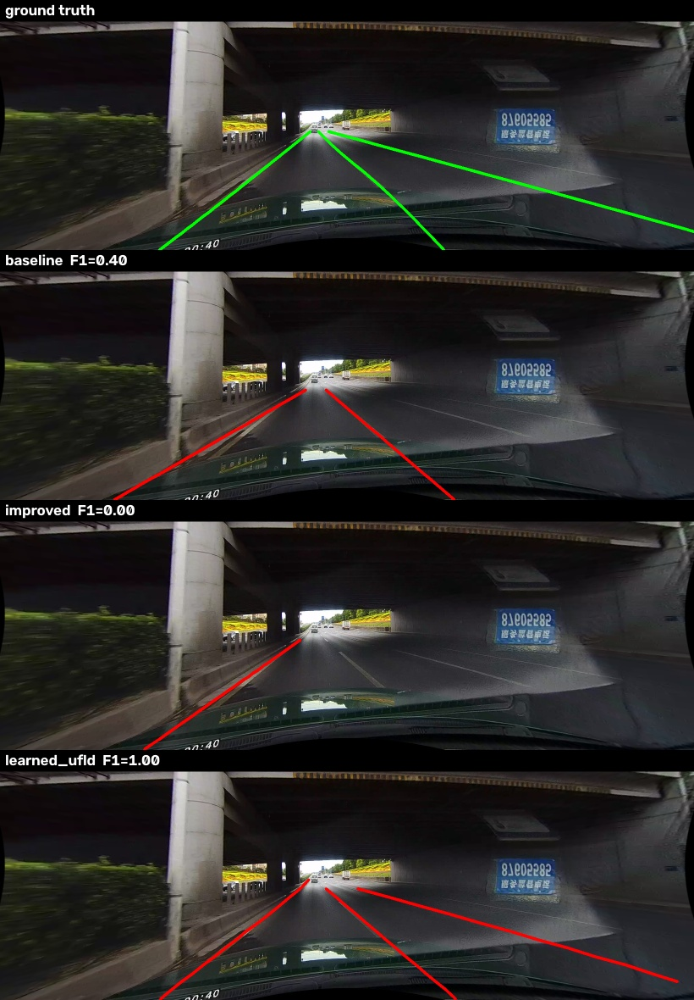
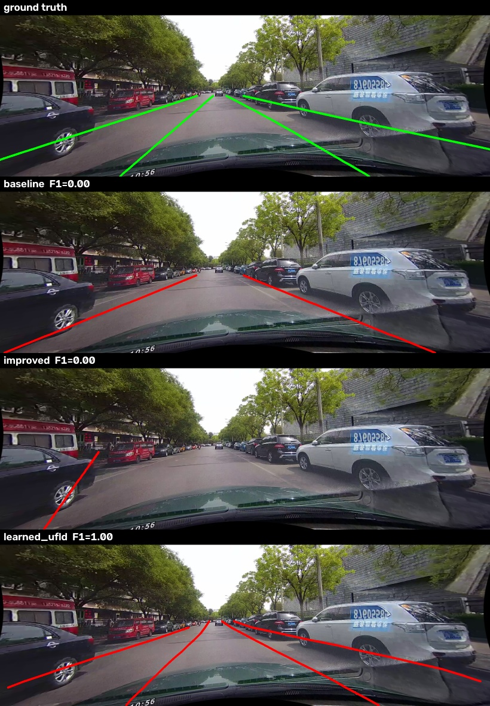

# Classical vs. Learned Lane Detection on CULane

A Digital Image Processing course project (HSR-AIML-049) built, evaluated and documented end to
end: a hand-built classical computer-vision pipeline for finding lane markings in road photos,
measured against both a simpler classical baseline and a pretrained deep-learning model, on 1,250
real test photos from the public CULane benchmark.

**Headline result:** on clean roads, a carefully tuned classical pipeline modestly beats a naive
one (F1 0.26 vs 0.25) and does clearly better in crowded traffic (0.14 vs 0.08) — but a pretrained
CNN beats both classical methods on every single condition (0.36–0.88 F1), by a wide margin. The
project's real contribution is not "we beat deep learning" — it's a rigorous, honest comparison
that shows *exactly where* classical image processing holds up, where it breaks, and why.

| | |
|---|---|
| 🏁 Course | DIP (HSR-AIML-049) | 👥 Team | 2 people |
| 📊 Dataset | [CULane](https://xingangpan.github.io/projects/CULane.html), 1,250 test photos | 🧪 Methods | 3 (classical baseline, classical improved, pretrained CNN) |
| ✅ Tests | 11/11 passing | 📄 License | MIT |

---

## Table of contents

1. [Problem and data](#problem-and-data)
2. [The three methods](#the-three-methods)
3. [How scoring works](#how-scoring-works)
4. [Results](#results)
5. [What each pipeline stage is worth (ablation)](#what-each-pipeline-stage-is-worth-ablation)
6. [Failure analysis](#failure-analysis)
7. [Limitations — read this before citing any number here](#limitations--read-this-before-citing-any-number-here)
8. [Repository layout](#repository-layout)
9. [Reproducing everything](#reproducing-everything)
10. [Contributions](#contributions)

---

## Problem and data

Lane detection from a single dashcam-style photo is the task of drawing the lines a driver would
follow, even when they're faded, in shadow, hard to see at night, or not marked at all. We use the
**test split of [CULane](https://xingangpan.github.io/projects/CULane.html)**, a public lane
dataset built from 55+ hours of driving footage across six vehicles in Beijing, with each scored
lane hand-annotated as a sequence of (x, y) points. CULane's test set is pre-split by how hard the
photo is; we evaluate on five of those splits, 250 photos each (1,250 photos total, sampled with a
fixed seed so results are reproducible):

| Condition | What makes it hard |
|---|---|
| **Normal** | Clear road, good light — the easy case |
| **Crowded** | Heavy traffic partly occluding the lanes |
| **Shadow** | Hard light/dark boundaries (bridges, tunnels, trees) |
| **No line** | No visible paint at all for some stretch of road |
| **Night** | Low light, headlight glare, reflections |

CULane is licensed for non-commercial research use and may not be redistributed, so the raw
images are **not** in this repository — only code, documentation and small result files are
committed. See [`data/README.md`](data/README.md) for exactly what to download and where it goes.

## The three methods

All three take the same photo and are scored exactly the same way, so the comparison is fair.



*(Full diagram with every intermediate step: [docs/lane_detection_architecture.md](docs/lane_detection_architecture.md))*

### 1. Baseline — the simple classical method

`lanekit/baseline.py`. Grayscale → 5×5 Gaussian blur → Canny edges (thresholds 50/150) → cut to
the road-area trapezoid → probabilistic Hough transform finds line segments → segments are split
left/right by slope and combined into one straight line per side, weighted by segment length. No
tuning beyond the textbook defaults. This is the "what happens if you don't try very hard" control.

### 2. Improved — the hand-tuned classical pipeline (Person A)

`lanekit/improved.py`. Nine stages, every one saved to disk so it can be inspected directly:

<p align="center"></p>

1. **Enhancement** — CLAHE on the LAB lightness channel evens out local contrast; frames that are
   globally dark additionally get a gamma lookup table (γ = 0.6) applied first.
2. **Colour masks** — a morphological *top-hat* (the image minus its own wide-kernel opening) on
   HLS lightness finds any stripe clearly brighter than the road right beside it — this is what
   finds white paint, including faded paint, without one fixed brightness threshold that would
   behave differently in sun versus shade. A separate HLS hue/saturation range finds yellow paint.
3. **Road-area mask** — cut to a trapezoid in front of the car, so guardrails and kerbs near the
   frame edges can't be mistaken for lanes.
4. **Bird's-eye warp** — a perspective transform maps the road to a top-down view. The warp
   quadrilateral was **not guessed**: it was measured from CULane's own ground-truth lane labels
   (`scripts/calibrate_geometry.py`) — the vanishing point sits at 45% across, 51% down the frame,
   and the two ego-lanes meet the bottom edge at about 23% and 74% across.
5. **Sliding window** — nine stacked windows step upward from the strongest paint column in each
   of two fixed left/right search bands, re-centring as they go; a side is only accepted if paint
   appeared in at least 3 of the 9 windows, so one stray bright pixel can't be read as a lane.
6. **Fit** — a straight line by default; a 2nd-degree curve only when the paint found spans at
   least 85% of the search height (CULane's lanes are close to straight over the scored range, so
   this stops curvature being fit to noise on short paint fragments).
7. **Extend, warp back, draw** — the fitted line is extended toward the horizon, mapped back into
   the camera view, and drawn on the original photo.

Full stage-by-stage images for every condition: [`docs/assets/stages_*.jpg`](docs/assets/).

### 3. Learned — Ultra-Fast Lane Detection (Person B)

`lanekit/learned.py`. [UFLD](https://github.com/cfzd/Ultra-Fast-Lane-Detection) (Qin et al.,
ECCV 2020), **pretrained on CULane by its original authors, used for inference only — nothing in
this project trained it.** It treats lane-finding as row-wise classification: for 18 fixed image
rows and 4 lane slots, it picks one of 200 horizontal grid positions (or "no lane"). The published
PyTorch checkpoint is exported to ONNX once (`scripts/export_ufld_onnx.py`) and run through
OpenCV's `cv2.dnn`, so the whole pipeline stays inside OpenCV with no PyTorch dependency at
inference time.

## How scoring works

`lanekit/evaluate.py`. Each predicted and each true lane is drawn as a 30-pixel-wide line on a
blank mask the size of the photo. Predicted and true lanes are paired up one-to-one by maximum
intersection-over-union (Hungarian/linear-sum assignment on the IoU matrix) — the same approach
CULane's own evaluation protocol uses. A pair counts as a match only when its IoU exceeds 0.5.
Unmatched predictions are false positives, unmatched true lanes are false negatives; precision,
recall and F1 are computed from the totals across all 250 photos in a condition, not averaged
per-photo. We separately report an **ego-F1** that scores only the two lanes nearest the car on
each side, since CULane labels up to 4 lanes per photo while both classical methods only look for
2 — ego-F1 is the fairer number for comparing the classical methods to each other.

## Results

250 photos per condition, 1,250 photos total, all three methods on identical inputs:

<p align="center"></p>

| Condition | Baseline | Improved | UFLD (learned) |
|---|---:|---:|---:|
| Normal | 0.2494 | **0.2613** | 0.8809 |
| Crowded | 0.0795 | **0.1356** | 0.7254 |
| Shadow | **0.1257** | 0.0546 | 0.6772 |
| No line | **0.0759** | 0.0193 | 0.3618 |
| Night | **0.1627** | 0.0617 | 0.6319 |

*(Full table with precision/recall/ego-F1/FPS: [docs/assets/results_table.md](docs/assets/results_table.md).
Raw CSV: [docs/assets/results.csv](docs/assets/results.csv).)*

**Speed** (same hardware): baseline 119–256 photos/s, improved 34–52 photos/s, UFLD 11–13 photos/s.
Classical methods are 5–20× faster but far less accurate — the expected accuracy/speed trade-off
between hand-built rules and a trained model.

**Reading the numbers:** the improved pipeline beats the baseline exactly where its assumption
holds — clean, unobstructed paint (normal, crowded) — and loses everywhere that assumption breaks
(shadow, no-line, night). UFLD wins every condition, which is expected and not a finding by
itself (it's a trained model solving the exact task it was trained for); *why* and *by how much*
it wins, and exactly where each classical stage helps or hurts, is the actual content of this
project — covered next.

## What each pipeline stage is worth (ablation)

Every stage of the improved pipeline was switched off (or on, for two stages that are off by
default) one at a time and re-scored on the same photos:

| Version | Normal | Crowded | Shadow | No line | Night |
|---|---:|---:|---:|---:|---:|
| **Full pipeline** | 0.2613 | 0.1356 | 0.0546 | 0.0193 | 0.0617 |
| Without enhancement | 0.1792 | 0.0588 | 0.0202 | 0.0060 | 0.0561 |
| Without colour masks (edges instead) | 0.2243 | 0.1139 | 0.0537 | 0.0179 | **0.0973** |
| Without bird's-eye warp | 0.0542 | 0.0233 | 0.0085 | 0.0101 | 0.0053 |
| *(off by default)* with gap-filling added | 0.2414 | 0.1257 | 0.0596 | 0.0262 | 0.0567 |
| *(off by default)* with curve fitting added | 0.2312 | 0.1216 | 0.0430 | 0.0211 | 0.0534 |

*(Full table: [docs/assets/ablation_table.md](docs/assets/ablation_table.md))*

- **The bird's-eye warp matters most, by far.** Removing it costs 80% of normal-road F1
  (0.26 → 0.05). Without it, the two lanes converge toward the vanishing point and overlap in the
  same image columns near the top of frame, which breaks the fixed-band column search.
- **Enhancement is second.** CLAHE recovers contrast in the darker lower half of the frame, where
  the closest and most reliable paint is. Removing it costs a third of normal-road F1.
- **Colour masks are a net win — except at night**, where they actively hurt (0.062 → 0.097
  *without* them). Headlight glare and wet-road reflections are brighter than real paint, so the
  top-hat filter finds the glare instead; a plain edge mask is less fooled by smooth, sharp-free
  bright blobs than it is by painted lines.
- **Gap-filling and curve fitting were tested and left off by default.** Both slightly reduce F1
  on four of five conditions — CULane's scored segments are short and close to straight, so the
  extra freedom these stages add mostly introduces drift rather than fixing anything real. They're
  kept in the code as tested, working, switchable options (`Options(close=True)`,
  `Options(curves=True)`), not removed.

## Failure analysis

Three specific failures of the improved method, each traced to a concrete cause in the actual
mask/stage images — not a generic "it struggles in bad conditions."

<table><tr><td width="50%">

**Night — headlight glare mistaken for paint**

Both classical methods score F1 = 0.00 on this photo; UFLD scores 1.00. The white-paint mask
(`2_white` in the stage images) lights up a large diffuse blob from an oncoming car's headlights
and a wet-road reflection. That blob survives the road-area mask and the warp, and the sliding
window locks onto it instead of the real lane — producing a line through empty road at a steep,
wrong angle. This is the clearest demonstration in the project of why a brightness-based mask is
the wrong tool after dark: it can't distinguish "painted" from "merely bright."

</td><td>



</td></tr><tr><td width="50%">

**Shadow — a forking road at a tunnel exit**

At a hard light/dark boundary where the road genuinely splits, the improved method follows only
one branch and misses the fork (F1 = 0.00); the baseline's straight Hough lines happen to catch
one true lane well enough for partial credit (F1 = 0.40) on this specific photo. The fixed
bird's-eye quad assumes roughly one straight lane per side through the warp region — at a real
fork, the sliding window follows whichever branch its starting histogram peak happens to land on.

</td><td>



</td></tr><tr><td width="50%">

**No markings — nothing for a paint-based method to find**

Between parked cars on both sides, with no visible lane paint, both classical methods score
F1 = 0.00 — there is no paint for the colour masks to find, so the windows find nothing, or lock
onto car edges and kerb lines instead. UFLD scores 1.00 on the same photo. This is the sharpest
limitation of a paint-only method: it has no notion of "where the lane should be" beyond visible
paint, while the learned model was trained on cases where road edges, parked-car position and
context jointly imply the lane even without a line.

</td><td>



</td></tr></table>

**The pattern:** every improved-method failure traces back to the same root assumption — that lane
paint is simply "the brightest thin stripe near the road, running roughly straight through the
warp region." That holds on clean, well-lit, unobstructed roads (where it beats the baseline) and
breaks in exactly the three documented ways whenever something else is brighter than the paint,
the road geometry isn't a single straight stripe, or there's no paint at all.

Full writeups with more detail: [docs/person_a_contribution.md](docs/person_a_contribution.md)
(improved pipeline, ablation, failure analysis) and
[docs/person_b_contribution.md](docs/person_b_contribution.md) (data, baseline, evaluator, UFLD
integration).

## Limitations — read this before citing any number here

Listed here deliberately, rather than left implicit, because they change how the results should
be read:

- **This is a project-written evaluator, not CULane's official one.** It follows the same
  published protocol (30px lane width, IoU > 0.5, Hungarian matching) but is our own
  implementation. Numbers here are internally consistent and fairly compare the three methods to
  each other, but are **not directly comparable** to numbers in the UFLD paper or CULane
  leaderboards, which use the official evaluator and the full 34,680-photo test set (we use 1,250).
- **UFLD is used purely at inference time.** The 0.88/0.73/0.68/0.36/0.63 F1 scores are the
  original authors' trained model running on our data split, not a model this project trained or
  fine-tuned. The contribution on that side is export/integration engineering (PyTorch → ONNX →
  `cv2.dnn`), not modelling.
- **No Indian road data is used or scored.** All quantitative results come from CULane, filmed in
  Beijing. We deliberately chose not to collect our own footage, so there is no evaluated
  real-world test of these methods on Indian roads — only on CULane's five hard-condition splits,
  which cover similar *kinds* of difficulty (night, shadow, occlusion, missing paint) without
  being drawn from India specifically. This project's scope is a CULane benchmark study, not an
  India-specific one.
- **Temporal smoothing is implemented but not evaluated.** `lanekit/improved.py` includes a
  `LaneTracker` class (exponential-moving-average smoothing of the fitted curve across frames) for
  use on video. CULane's test split only provides photos sampled one second apart (every 30th
  frame of the source footage), not continuous video, so there is no data in this project on which
  smoothing could be meaningfully demonstrated — a one-second gap is too large for a smoothing
  demo to show anything but large jumps. The code is written, type-checked and unit-testable in
  isolation, but it has not been run against real sequential frames.
- **The ablation isolates one stage at a time, not interactions between stages.** It does not test
  every combination (e.g. "no enhancement *and* no colour masks together"), so it shows what each
  stage contributes on top of the others, not a full factorial breakdown.

## Repository layout

```
lanekit/    core pipelines, evaluation, data loading — the actual project code
scripts/    CLI tools: run_eval.py, make_figures.py, show_stages.py, calibrate_geometry.py,
            export_ufld_onnx.py
docs/       per-contributor writeups, pipeline diagram, and the committed results/figures
            (docs/assets/) referenced throughout this README
tests/      pytest — 11 tests covering the evaluator, both classical methods, and environment
data/       datasets (gitignored — not redistributed; see data/README.md)
outputs/    full-resolution figures regenerated locally (gitignored — see docs/assets/ for the
            committed, representative copies used in this README)
```

## Reproducing everything

Requires [uv](https://docs.astral.sh/uv/) and Python 3.12.

```bash
uv sync
uv run pytest                                                         # 11 tests

# Data: download CULane's list + one test archive into data/culane/ — see data/README.md
uv run python scripts/show_stages.py <folder-of-photos> outputs/improved   # stage images
uv run python scripts/run_eval.py --per-condition 250                      # -> outputs/results.csv
uv run python scripts/run_eval.py --per-condition 250 --ablation           # -> outputs/ablation.csv
uv run python scripts/make_figures.py                                      # tables/charts/comparisons
```

The learned method needs a one-time ONNX export: download `culane_18.pth` from the
[UFLD repository](https://github.com/cfzd/Ultra-Fast-Lane-Detection) into `models/`, clone that
repo to `models/ufld_repo`, then run `scripts/export_ufld_onnx.py`. Once
`models/ufld_culane_18.onnx` exists, every script above includes it automatically.

## Contributions

Full log: [CONTRIBUTIONS.md](CONTRIBUTIONS.md).

- **Person A** — the improved classical detector, its ablation study, and the failure analysis.
- **Person B** — data pipeline, the CULane-protocol evaluator, the baseline detector, and the UFLD
  ONNX export / `cv2.dnn` integration.
- All three-method evaluation results were independently re-run and verified to match exactly
  between both team members before being merged.

## License

MIT, see [LICENSE](LICENSE).
