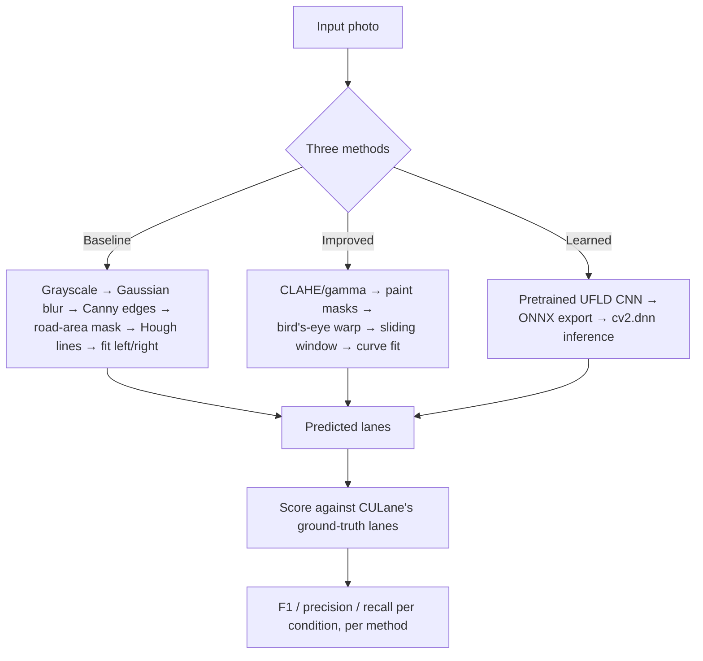
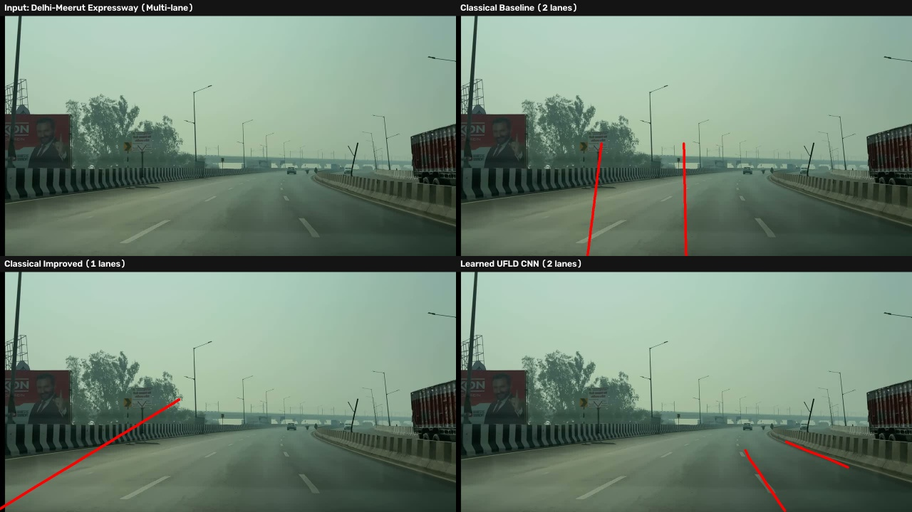
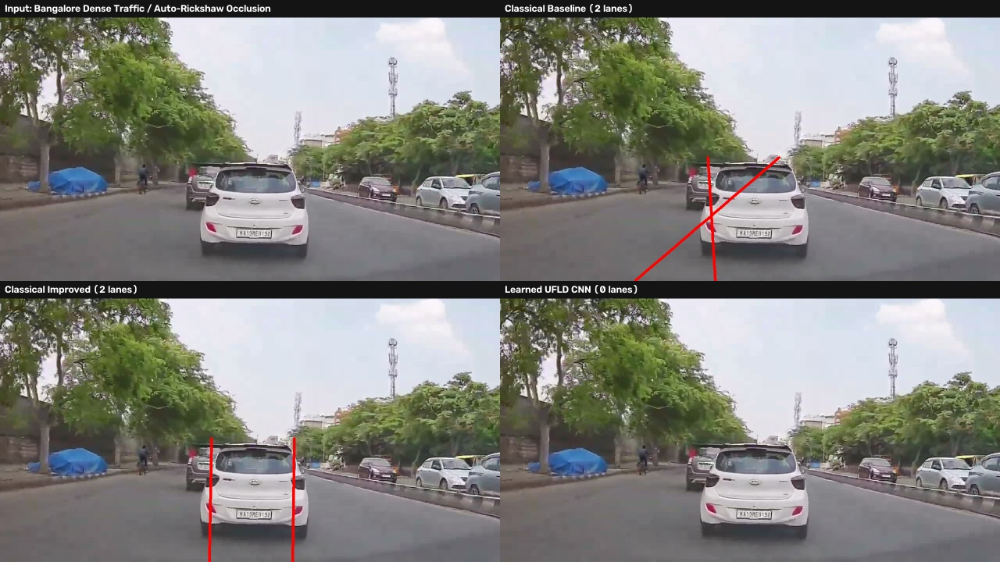
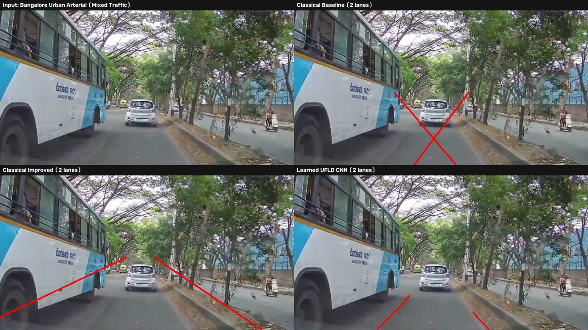
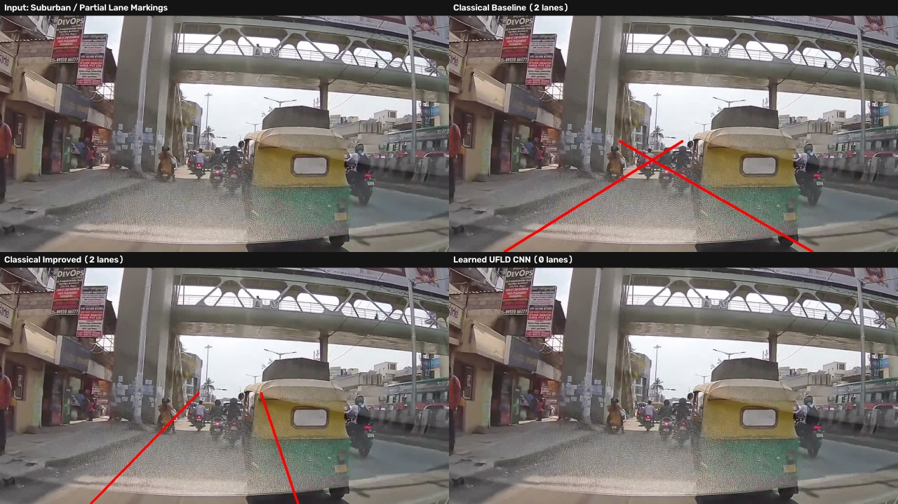

# Classical vs. Learned Lane Detection on CULane

A Digital Image Processing course project (HSR-AIML-049): a classical computer-vision pipeline
for finding lane markings in road photos, measured against a simpler classical baseline and a
pretrained deep-learning model, on 1,250 test photos from the public CULane benchmark.

**Headline result:** on clean roads, the tuned classical pipeline outperforms the simple baseline
(F1 0.26 vs 0.25) and does more clearly in crowded traffic (0.14 vs 0.08). A pretrained CNN
outperforms both classical methods on every condition (0.36–0.88 F1). The project includes a
per-stage ablation showing exactly which processing steps drive the classical pipeline's
performance, a set of documented failure cases, and a qualitative extension to Indian road
photography.

| | |
|---|---|
| 🏁 Course | DIP (HSR-AIML-049) | 👥 Team | 2 people |
| 📊 Dataset | [CULane](https://xingangpan.github.io/projects/CULane.html), 1,250 test photos | 🧪 Methods | 3 (classical baseline, classical improved, pretrained CNN) |
| ✅ Tests | 11/11 passing | 📄 License | MIT |

---

## Table of contents

1. [Problem and data](#problem-and-data)
2. [The three methods](#the-three-methods)
3. [How scoring works](#how-scoring-works)
4. [Results](#results)
5. [What each pipeline stage is worth (ablation)](#what-each-pipeline-stage-is-worth-ablation)
6. [Failure analysis](#failure-analysis)
7. [Qualitative study on Indian roads](#qualitative-study-on-indian-roads)
8. [Scope and evaluation notes](#scope-and-evaluation-notes)
9. [Repository layout](#repository-layout)
10. [Reproducing everything](#reproducing-everything)
11. [Contributions](#contributions)

---

## Problem and data

Lane detection from a single dashcam-style photo is the task of drawing the lines a driver would
follow, even when they are faded, in shadow, hard to see at night, or not marked at all. This
project uses the **test split of [CULane](https://xingangpan.github.io/projects/CULane.html)**, a
public lane dataset built from 55+ hours of driving footage across six vehicles in Beijing, with
each scored lane hand-annotated as a sequence of (x, y) points. CULane's test set is pre-split by
difficulty; evaluation here covers five of those splits, 250 photos each (1,250 photos total,
sampled with a fixed seed for reproducibility):

| Condition | What makes it hard |
|---|---|
| **Normal** | Clear road, good light |
| **Crowded** | Heavy traffic partly occluding the lanes |
| **Shadow** | Hard light/dark boundaries (bridges, tunnels, trees) |
| **No line** | No visible paint for some stretch of road |
| **Night** | Low light, headlight glare, reflections |

CULane is licensed for non-commercial research use and is not redistributed; only code,
documentation and small derived result files are in this repository. See
[`data/README.md`](data/README.md) for what to download and where it goes.

## The three methods

All three take the same photo and are scored the same way.



*(Full diagram with every intermediate step: [docs/lane_detection_architecture.md](docs/lane_detection_architecture.md))*

### 1. Baseline — simple classical method

`lanekit/baseline.py`. Grayscale → 5×5 Gaussian blur → Canny edges (thresholds 50/150) → road-area
trapezoid mask → probabilistic Hough transform for line segments → segments split left/right by
slope and combined into one straight line per side, weighted by segment length. Textbook defaults
throughout, no tuning.

### 2. Improved — hand-tuned classical pipeline (Aditya Pandey)

`lanekit/improved.py`. Nine stages, each saved to disk for inspection:

<p align="center"></p>

1. **Enhancement** — CLAHE on the LAB lightness channel evens out local contrast; frames with low
   global brightness additionally receive a gamma lookup table (γ = 0.6) first.
2. **Colour masks** — a morphological top-hat (the image minus its own wide-kernel opening) on HLS
   lightness finds any stripe brighter than the road beside it, locating paint including faded
   paint without a single fixed brightness threshold. A separate HLS hue/saturation range finds
   yellow paint.
3. **Road-area mask** — cut to a trapezoid in front of the car, excluding guardrails and kerbs near
   the frame edges.
4. **Bird's-eye warp** — a perspective transform maps the road to a top-down view. The warp
   quadrilateral is measured from CULane's own ground-truth lane labels
   (`scripts/calibrate_geometry.py`): the vanishing point sits at 45% across, 51% down the frame,
   and the two ego-lanes meet the bottom edge at about 23% and 74% across.
5. **Sliding window** — nine stacked windows step upward from the strongest paint column in each of
   two fixed left/right search bands, re-centring as they go; a side is accepted only if paint
   appeared in at least 3 of the 9 windows.
6. **Fit** — a straight line by default; a 2nd-degree curve only when the detected paint spans at
   least 85% of the search height.
7. **Extend, warp back, draw** — the fitted line is extended toward the horizon, mapped back into
   the camera view, and drawn on the original photo.

Full stage-by-stage images for every condition: [`docs/assets/stages_*.jpg`](docs/assets/).

### 3. Learned — Ultra-Fast Lane Detection (Shashank Patel)

`lanekit/learned.py`. [UFLD](https://github.com/cfzd/Ultra-Fast-Lane-Detection) (Qin et al., ECCV
2020), pretrained on CULane by its original authors, used for inference only. It treats
lane-finding as row-wise classification: for 18 fixed image rows and 4 lane slots, it selects one
of 200 horizontal grid positions, or "no lane." The published PyTorch checkpoint is exported to
ONNX once (`scripts/export_ufld_onnx.py`) and run through OpenCV's `cv2.dnn`, keeping inference
inside OpenCV with no PyTorch dependency at run time.

## How scoring works

`lanekit/evaluate.py`. Each predicted and each true lane is drawn as a 30-pixel-wide line on a
blank mask the size of the photo. Predicted and true lanes are paired one-to-one by maximum
intersection-over-union (Hungarian/linear-sum assignment on the IoU matrix), following CULane's
published evaluation approach. A pair counts as a match when its IoU exceeds 0.5. Unmatched
predictions are false positives, unmatched true lanes are false negatives; precision, recall and
F1 are computed from totals across all 250 photos in a condition, not averaged per photo. An
**ego-F1** metric additionally scores only the two lanes nearest the car on each side, since
CULane labels up to 4 lanes per photo while both classical methods search for 2.

## Results

250 photos per condition, 1,250 photos total, all three methods on identical inputs:

<p align="center"></p>

| Condition | Baseline | Improved | UFLD (learned) |
|---|---:|---:|---:|
| Normal | 0.2494 | **0.2613** | 0.8809 |
| Crowded | 0.0795 | **0.1356** | 0.7254 |
| Shadow | **0.1257** | 0.0546 | 0.6772 |
| No line | **0.0759** | 0.0193 | 0.3618 |
| Night | **0.1627** | 0.0617 | 0.6319 |

*(Full table with precision/recall/ego-F1/FPS: [docs/assets/results_table.md](docs/assets/results_table.md).
Raw CSV: [docs/assets/results.csv](docs/assets/results.csv).)*

**Speed** (same hardware): baseline 119–256 photos/s, improved 34–52 photos/s, UFLD 11–13 photos/s.
Classical methods are 5–20× faster and markedly less accurate, the expected accuracy/speed
trade-off between hand-built rules and a trained model.

The improved pipeline outperforms the baseline where its underlying assumption holds — clean,
unobstructed paint, as on normal and crowded roads — and underperforms it on shadow, no-line and
night roads, where that assumption breaks down (Section 6). UFLD outperforms both classical
methods on every condition, consistent with it being a model trained specifically for this task
on this dataset. Sections 5 and 6 cover which pipeline stages drive the improved method's
performance and where each method fails.

## What each pipeline stage is worth (ablation)

Each stage of the improved pipeline was individually disabled (or, for two stages disabled by
default, individually enabled) and re-scored on the same photos:

| Version | Normal | Crowded | Shadow | No line | Night |
|---|---:|---:|---:|---:|---:|
| **Full pipeline** | 0.2613 | 0.1356 | 0.0546 | 0.0193 | 0.0617 |
| Without enhancement | 0.1792 | 0.0588 | 0.0202 | 0.0060 | 0.0561 |
| Without colour masks (edges instead) | 0.2243 | 0.1139 | 0.0537 | 0.0179 | **0.0973** |
| Without bird's-eye warp | 0.0542 | 0.0233 | 0.0085 | 0.0101 | 0.0053 |
| *(off by default)* with gap-filling added | 0.2414 | 0.1257 | 0.0596 | 0.0262 | 0.0567 |
| *(off by default)* with curve fitting added | 0.2312 | 0.1216 | 0.0430 | 0.0211 | 0.0534 |

*(Full table: [docs/assets/ablation_table.md](docs/assets/ablation_table.md))*

- **The bird's-eye warp contributes the most.** Removing it costs 80% of normal-road F1 (0.26 →
  0.05). Without it, the two lanes converge toward the vanishing point and overlap in the same
  image columns near the top of frame, breaking the fixed-band column search.
- **Enhancement contributes second-most.** CLAHE recovers contrast in the darker lower half of the
  frame, where the closest and most reliable paint is located. Removing it costs about a third of
  normal-road F1.
- **Colour masks improve most conditions and reduce night performance** (0.062 → 0.097 without
  them). Headlight glare and wet-road reflections are brighter than paint, so the top-hat filter
  responds to the glare; a plain edge mask is less affected by smooth bright regions than by
  painted lines.
- **Gap-filling and curve fitting are disabled by default.** Both reduce F1 on four of five
  conditions. CULane's scored segments are short and close to straight, so the added flexibility
  tends to introduce drift. Both remain implemented as switchable options
  (`Options(close=True)`, `Options(curves=True)`).

## Failure analysis

Three failures of the improved method, traced to specific causes visible in the stage images.

<table><tr><td width="50%">

**Night — headlight glare mistaken for paint**

Both classical methods score F1 = 0.00 on this photo; UFLD scores 1.00. The white-paint mask
(`2_white` in the stage images) activates on a diffuse region from an oncoming car's headlights
and a wet-road reflection. That region survives the road-area mask and the warp, and the sliding
window locks onto it instead of the real lane, producing a line through empty road at a steep,
incorrect angle. A brightness-based mask has no way to distinguish painted surfaces from surfaces
that are merely bright.

</td><td>


</td></tr><tr><td width="50%">

**Shadow — a forking road at a tunnel exit**

At a hard light/dark boundary where the road splits, the improved method follows only one branch
(F1 = 0.00); the baseline's straight Hough lines capture one true lane well enough for partial
credit (F1 = 0.40) on this photo. The fixed bird's-eye quad assumes roughly one straight lane per
side through the warp region; at a fork, the sliding window follows whichever branch its starting
histogram peak lands on.

</td><td>


</td></tr><tr><td width="50%">

**No markings — nothing for a paint-based method to find**

Between parked cars with no visible lane paint, both classical methods score F1 = 0.00: there is
no paint for the colour masks to find, so the windows find nothing or lock onto car edges and kerb
lines. UFLD scores 1.00 on the same photo. A paint-only method has no notion of where a lane
should be beyond visible paint; the learned model was trained on cases where road edges and
context jointly imply lane position without a visible line.

</td><td>


</td></tr></table>

Each documented failure of the improved method traces to the same assumption: that lane paint is
the brightest thin stripe near the road, running approximately straight through the warp region.
That assumption holds on clean, well-lit, unobstructed roads and fails in the three ways above
whenever something else in the scene is brighter than the paint, the road geometry is not a single
straight stripe, or no paint is present.

Full writeups: [Aditya Pandey](docs/person_a_contribution.md) (improved pipeline, ablation, failure
analysis) and [Shashank Patel](docs/person_b_contribution.md) (data, baseline, evaluator, UFLD
integration).

## Qualitative study on Indian roads

All three methods were run on four Indian road photographs: single frames extracted via `ffmpeg`
from publicly available dashcam-style driving footage. The source photos are not committed to this
repository, for the same reason as CULane — see [data/README.md](data/README.md).

1. **Multi-lane expressway** (Delhi–Meerut Expressway) — structured, well-marked, overhead gantries.
2. **Dense mixed urban traffic** (Bengaluru) — tight following distances, auto-rickshaws, two-wheelers.
3. **Urban arterial under a flyover** (Bengaluru) — a bus and heavy tree canopy largely hiding the road.
4. **Suburban underpass with no visible lane paint** (Bengaluru) — autorickshaws, motorcycles, no markings.

<table>
<tr>
<th width="50%">Multi-Lane Expressway (Structured)</th>
<th width="50%">Urban Mixed Traffic (Dense Occlusion)</th>
</tr>
<tr>
<td></td>
<td></td>
</tr>
<tr>
<th width="50%">Urban City Arterial</th>
<th width="50%">Suburban / Partial Markings</th>
</tr>
<tr>
<td></td>
<td></td>
</tr>
</table>

### Measured result on the expressway photo

The expressway photo's two dashed lane lines were labelled with ground-truth coordinates and
scored with the same evaluator and IoU > 0.5 rule used throughout this project
([docs/assets/india_results.csv](docs/assets/india_results.csv)):

| Scene | Baseline | Improved | UFLD |
|---|---:|---:|---:|
| Expressway | F1 0.00 | F1 0.00 | F1 0.00 (best match IoU 0.39) |

UFLD's predicted lane overlaps the true lane at IoU 0.39, close to but below the 0.5 match
threshold. The three Bengaluru photos contain no visible lane paint, so their true lane count is
zero and any predicted line scores as a false positive — the same convention CULane applies to its
own no-lane photos.

### Per-scene behaviour

| Scene | Baseline | Improved | UFLD |
|---|---|---|---|
| Expressway | 2 lanes, tracking the dashed markings | 1 lane, locked onto the median guardrail's stripe pattern | 2 lanes, near-correct but short of the match threshold |
| Dense traffic | 2 lines crossing through the lead car | 2 diverging lines running into roadside trees | 0 lanes found |
| Urban/flyover | 2 lines crossing through a bus | 2 diverging lines into the tree canopy on both sides | 2 lines directed toward the bus rather than the road |
| Suburban/no paint | 2 lines crossing through a pillar and an autorickshaw | 2 lines through a pillar and parked motorcycles | 0 lanes found |

The classical methods' failure mode matches the pattern documented in [Failure
analysis](#failure-analysis): the improved pipeline's colour/top-hat masks and the baseline's
Hough lines latch onto high-contrast structures near the expected lane position — guardrail
stripes, tree trunks, parked vehicles — when no genuine paint is present.

UFLD, the leading method on every CULane condition including `no_line` (0.36 F1 versus under 0.02
for both classical methods), detects zero lanes on two of the four Indian photos and misses the
match threshold on the one photo with a measured score. A model trained on one country's road
markings, signage density, vehicle composition and camera geometry does not necessarily transfer
to another country's roads, independent of how strongly it outperforms classical methods within
its training distribution.

## Scope and evaluation notes

- **Evaluator.** `lanekit/evaluate.py` implements CULane's published scoring protocol (30px lane
  width, IoU > 0.5, Hungarian matching) as an independent implementation, not CULane's official
  evaluator. Results compare the three methods to each other consistently but are not directly
  comparable to numbers in the UFLD paper or CULane leaderboards, which use the official evaluator
  and the full 34,680-photo test set.
- **UFLD.** Used at inference time only. The reported F1 scores are the original authors' trained
  model evaluated on this project's data split; this project's contribution on that side is export
  and integration engineering (PyTorch → ONNX → `cv2.dnn`), not model training.
- **Indian-roads study.** Four photographs: one with measured ground truth, three with zero true
  lanes by inspection. This is a small, targeted qualitative extension, not a benchmark.
- **Temporal smoothing.** `lanekit/improved.py` includes a `LaneTracker` class for
  exponential-moving-average smoothing of the fitted curve across video frames. CULane's test
  split provides photos sampled one second apart (every 30th frame of the source footage), not
  continuous video, so this component is implemented and tested in isolation but not demonstrated
  against sequential frames within this project's dataset.
- **Ablation scope.** Each stage is isolated independently, not in combination; the table reports
  what each stage contributes on top of the full pipeline, not a complete factorial analysis.

## Repository layout

```
lanekit/    core pipelines, evaluation, data loading
scripts/    run_eval.py, make_figures.py, show_stages.py, calibrate_geometry.py,
            export_ufld_onnx.py, evaluate_indian_roads.py, label_india_ground_truth.py,
            score_india_roads.py
docs/       per-contributor writeups, pipeline diagram, and committed results/figures
            (docs/assets/) referenced throughout this README
tests/      pytest — 11 tests covering the evaluator, both classical methods, and environment
data/       datasets (gitignored, not redistributed; see data/README.md)
outputs/    figures regenerated locally (gitignored; see docs/assets/ for committed copies)
```

## Reproducing everything

Requires [uv](https://docs.astral.sh/uv/) and Python 3.12.

```bash
uv sync
uv run pytest                                                         # 11 tests

# Data: download CULane's list + one test archive into data/culane/ — see data/README.md
uv run python scripts/show_stages.py <folder-of-photos> outputs/improved   # stage images
uv run python scripts/run_eval.py --per-condition 250                      # -> outputs/results.csv
uv run python scripts/run_eval.py --per-condition 250 --ablation           # -> outputs/ablation.csv
uv run python scripts/make_figures.py                                      # tables/charts/comparisons

# Optional: the Indian-roads comparisons (needs data/india_samples/ — see data/README.md)
uv run python scripts/evaluate_indian_roads.py

# Optional: label and score ground truth on the Indian photos (needs a display)
uv run python scripts/label_india_ground_truth.py
uv run python scripts/score_india_roads.py
```

The learned method needs a one-time ONNX export: download `culane_18.pth` from the
[UFLD repository](https://github.com/cfzd/Ultra-Fast-Lane-Detection) into `models/`, clone that
repo to `models/ufld_repo`, then run `scripts/export_ufld_onnx.py`. Once
`models/ufld_culane_18.onnx` exists, every script above includes it automatically.

## Contributions

Full log: [CONTRIBUTIONS.md](CONTRIBUTIONS.md).

- **Aditya Pandey** — the improved classical detector, its ablation study, and the failure analysis.
- **Shashank Patel** — data pipeline, the CULane-protocol evaluator, the baseline detector, and the UFLD
  ONNX export / `cv2.dnn` integration.
- All three-method evaluation results were independently re-run by both team members and matched
  before being merged.

## License

MIT, see [LICENSE](LICENSE).
