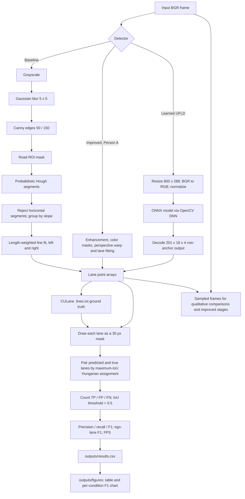

# Lane detection pipeline architecture

The diagram summarizes the paths implemented in `lanekit/baseline.py`, `lanekit/improved.py`,
`lanekit/learned.py`, `lanekit/evaluate.py`, and the evaluation/figure scripts. The report scores
are read from `outputs/results.csv`; generating qualitative comparisons runs the detectors again
on a smaller sample and does not rewrite that CSV.
